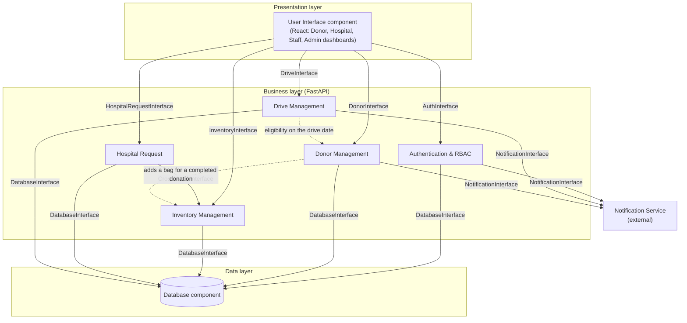
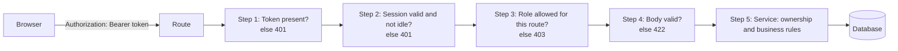
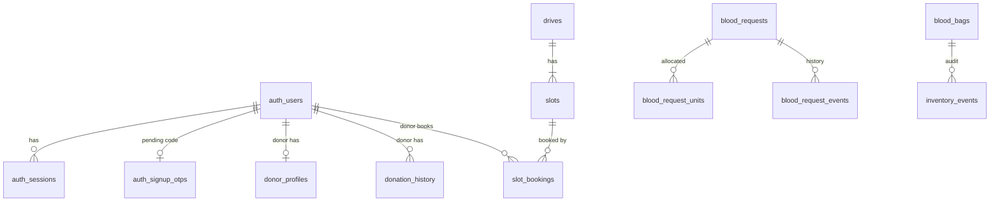
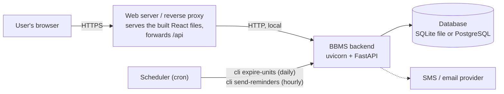
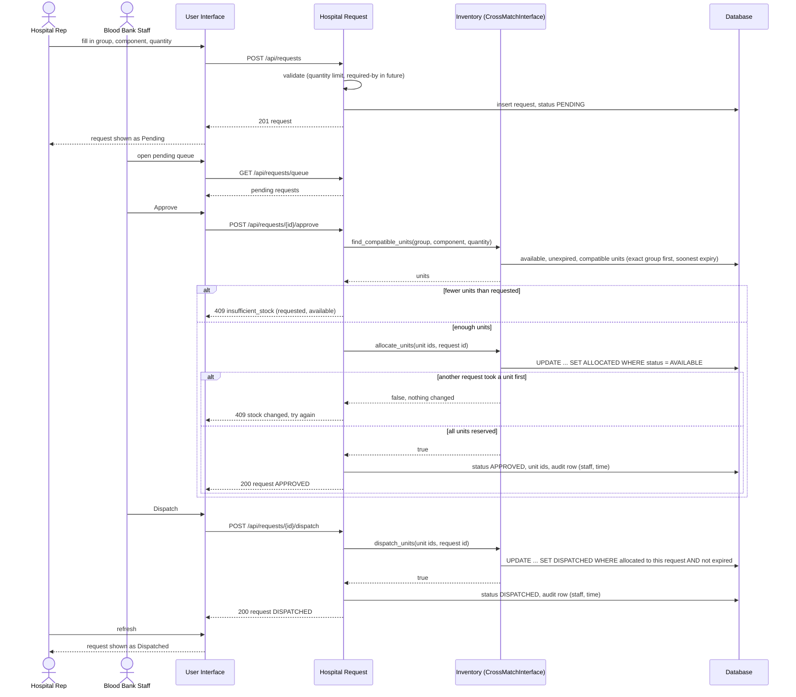
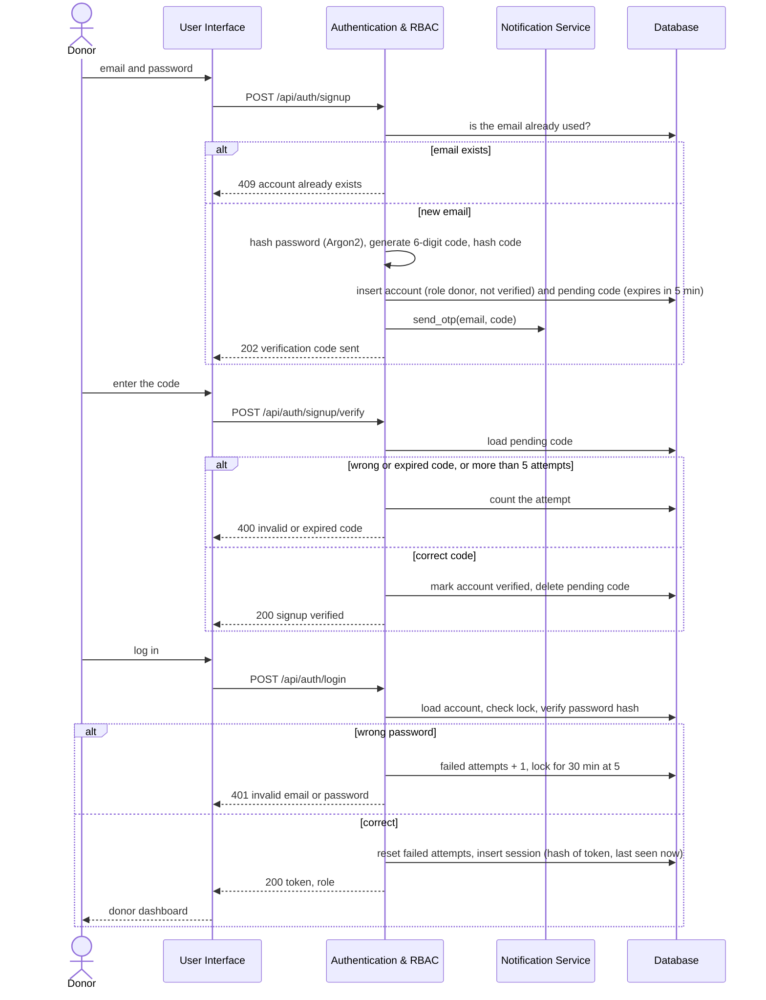
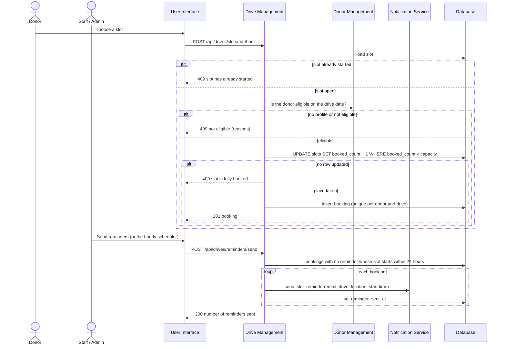
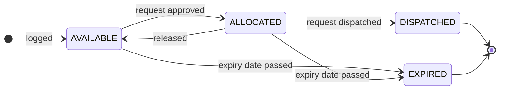
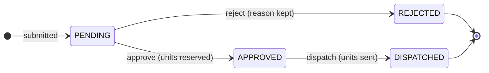

# Software Architecture & Design Specification (SAD)

**Blood Bank & Donation Management System (BBMS)**

| | |
|---|---|
| Project | A System to Manage Blood Donation and Availability in Blood Banks |
| Team | T9 |
| Version | 1.0 |
| Date | 20-11-2026 |
| Status | Describes the system as built at the end of Sprint 2 |

## Table of contents

1. Introduction
2. Architecture
   - 2.1 Architectural pattern
   - 2.2 Component diagram
   - 2.3 Component description
   - 2.4 Interfaces between components
   - 2.5 Traceability to requirements
   - 2.6 Security architecture
   - 2.7 Data architecture
   - 2.8 Deployment view
3. Design
   - 3.1 Module structure
   - 3.2 Sequence diagrams
   - 3.3 API design
   - 3.4 Error handling
   - 3.5 State and concurrency design
   - 3.6 Configuration
4. Design decisions and constraints
5. Known limitations

## 1. Introduction

### 1.1 Purpose

This document describes the architecture and the detailed design of the Blood Bank &
Donation Management System. It shows how the requirements in the SRS are divided among
components, how those components talk to each other, and how the main operations work
step by step. It is written for the developers and testers of the project and for the
course evaluators.

### 1.2 Scope

The system is a web application for one blood bank. It covers login for four roles, donor
registration and eligibility, blood inventory with expiry, hospital requests with
cross-matching and dispatch, and donation drives with slot booking and reminders. This
document covers the backend (Python, FastAPI), the frontend (React) at the level of its
interaction with the backend, and the database.

### 1.3 Definitions

| Term | Meaning |
|---|---|
| RBAC | Role-Based Access Control |
| OTP | One-Time Password, the six-digit code sent at signup |
| Unit / bag | One blood bag in inventory |
| Cross-match | Finding units in stock that are compatible with a hospital request |
| Component (blood) | Whole Blood, RBC, Platelets or Plasma |
| ORM | Object-Relational Mapper (SQLAlchemy) |
| Service | A module's business-rule layer, between its HTTP routes and the database |

### 1.4 References

- Software Requirements Specification, BBMS v1.0 (`Blood_Bank_Management_System_SRS(1)(1).pdf`)
- Component diagram (`Bloodbank_management_UML_comp.pdf`)
- Architecture selection justification (`BBS_Justification.pdf`)
- Software Test Plan, BBMS v1.0 (`Test_Plan_Blood_Bank_Management_System.pdf`)
- Test Case Document (`docs/Test_Cases.md`)
- Deviations from the submitted documents (`docs/Deviations.md`)
- IEEE Std 1016, Software Design Descriptions

### 1.5 Overview

Section 2 gives the architecture: pattern, components, interfaces, traceability, security
and data. Section 3 gives the design: module structure, sequence diagrams, the API, error
handling and concurrency. Sections 4 and 5 record the main decisions and the limitations.

## 2. Architecture

### 2.1 Architectural pattern

BBMS uses a **layered architecture** with three layers.

| Layer | Contents | Technology |
|---|---|---|
| Presentation | One User Interface component with a dashboard per role | React 18, Vite |
| Business | Five components: Authentication & RBAC, Donor Management, Inventory Management, Hospital Request, Drive Management | Python, FastAPI |
| Data | One Database component | SQLAlchemy 2, SQLite (PostgreSQL supported) |

A layer only calls the layer directly below it. The frontend never reaches the database,
and the database is only reached through the business layer.

Why layered, and not microservices:

1. The five feature areas of the SRS (sections 4.1 to 4.5) map one to one onto five
   business components behind one user interface and one database. The SRS calls the
   product "a simple web application" for one organisation, so separately deployed
   services would add operating cost with no benefit.
2. BBS-NF-005 (two staff must never allocate the same unit) is solved by one database
   statement inside one process. Across separate services it would need distributed locks.
3. Every request passes through one business layer, so role checks (BBS-SR-003) and audit
   logging (BBS-SR-004) are enforced in one place and cannot be bypassed.
4. Inventory search (BBS-NF-001) is one in-process call plus one query, with no network
   hop between services. Measured at about 2 ms with 300 units in stock (system test ST-17).

Inside the business layer every component repeats the same three sub-layers:
`routes` (HTTP only) -> `service` (business rules) -> `models` / `repository` (database).

### 2.2 Component diagram

The UML component diagram with provided and required interfaces (ball and socket) is in
`Bloodbank_management_UML_comp.pdf`. The same structure, as built:



Authentication & RBAC also guards every other business component: each route receives a
`require_role(...)` check from it (section 2.6). That dependency is left out of the diagram
to keep it readable.

### 2.3 Component description

| Component | Responsibility | Code | Provides |
|---|---|---|---|
| User Interface | Login and signup pages; one dashboard per role; sends JSON requests with the session token; refreshes every 10 seconds | `src/frontend/src/` | Web pages |
| Authentication & RBAC | Login, sessions with inactivity timeout, logout, account lockout, donor signup with OTP, admin creation of staff / hospital / admin accounts, role checks for every other component | `src/backend/auth/` | AuthInterface |
| Donor Management | Donor profile, eligibility rules, donation history, recording a donation, emergency donor call-out | `src/backend/donor/` | DonorInterface |
| Inventory Management | Logging blood bags with unique IDs, expiry date by component, expiry run with audit, available stock, low-stock alerts, the cross-match implementation | `src/backend/inventory/` | InventoryInterface, CrossMatchInterface |
| Hospital Request | Submit and track requests, preview compatible units, approve, reject, dispatch, request history | `src/backend/hospital_requests/` | HospitalRequestInterface |
| Drive Management | Create drives with slots, list upcoming drives, book a slot, send reminders | `src/backend/drives/` | DriveInterface |
| Database | Stores all records; enforces uniqueness and check constraints | `src/backend/database.py`, each component's models | DatabaseInterface |
| Notification Service | Delivers OTPs and reminders. External. In development a stand-in writes them to the server log | `src/backend/notifications.py` | NotificationInterface |

Shared code used by several components: `blood.py` (blood groups, components,
compatibility rules), `config.py` (settings), `main.py` (builds the application and
connects the components), `cli.py` (operator commands).

### 2.4 Interfaces between components

| Interface | From -> To | Form | Operations |
|---|---|---|---|
| AuthInterface, DonorInterface, InventoryInterface, HospitalRequestInterface, DriveInterface | User Interface -> business components | REST, JSON over HTTP, bearer token | Section 3.3 |
| CrossMatchInterface | Hospital Request -> Inventory | In-process calls on a Python `Protocol` | `find_compatible_units`, `allocate_units`, `release_units`, `dispatch_units` |
| DatabaseInterface | Business components -> Database | SQLAlchemy sessions, one per HTTP request | Queries and transactions |
| NotificationInterface | Auth, Drives, Donor -> Notification Service | In-process calls on a Python `Protocol` | `send_otp`, `send_slot_reminder` |

CrossMatchInterface is the only way Hospital Request touches stock. Hospital Request has
no foreign keys into the inventory tables and stores unit IDs as plain text, so the two
components can change independently.

No component imports the application. Each one exposes a factory, for example
`create_inventory_router(get_session, require_role)`, and `main.py` passes in what it
needs. This is what lets the unit tests run one component with fakes for its neighbours.

### 2.5 Traceability to requirements

| Requirement | Component | Main code | Interface / endpoint | Test case |
|---|---|---|---|---|
| BBS-F-001 Login for four roles | Authentication & RBAC | `auth/service.py`, `auth/routes.py`, `auth/accounts.py` | `POST /api/auth/login`, `GET /api/auth/me` | TC-Auth-01, TC-Auth-04 |
| BBS-F-002 OTP at signup | Authentication & RBAC, Notification | `auth/signup.py`, `auth/otp.py` | `POST /api/auth/signup`, `/signup/verify` | TC-Auth-02 |
| BBS-F-003 Lock after 5 attempts | Authentication & RBAC | `auth/service.py` | `POST /api/auth/login` | TC-Auth-03 |
| BBS-F-010 Donor profile | Donor Management | `donor/service.py`, `donor/profile_routes.py` | `POST/GET /api/donors/profile` | TC-Donor-01 |
| BBS-F-011 Eligibility rules | Donor Management | `donor/eligibility.py` | `GET /api/donors/me/eligibility` | TC-Donor-02 |
| BBS-F-012 Donation history | Donor Management | `donor/donations.py`, `donor/service.py` | `GET /api/donors/me/donations`, `POST /api/donors/{id}/donations` | TC-Donor-03 |
| BBS-F-020 Unique bag ID | Inventory Management | `inventory/service.py` | `POST /api/inventory/bags`, `GET /api/inventory/bags/{unit_id}` | TC-Inv-01 |
| BBS-F-021 Component and expiry | Inventory Management | `inventory/service.py` | `POST /api/inventory/bags` | TC-Inv-02 |
| BBS-F-022 Expired units leave stock | Inventory Management | `inventory/service.py` | `GET /api/inventory/bags`, `POST /api/inventory/expire` | TC-Inv-03 |
| BBS-F-030 Submit a request | Hospital Request | `hospital_requests/service.py` | `POST /api/requests`, `GET /api/requests/queue` | TC-Hosp-01 |
| BBS-F-031 Suggest compatible units | Hospital Request, Inventory | `blood.py`, `inventory/cross_match.py` | CrossMatchInterface, `GET /api/requests/{id}/matches` | TC-Hosp-02 |
| BBS-F-032 Approve and dispatch | Hospital Request, Inventory | `hospital_requests/service.py` | `POST /api/requests/{id}/approve`, `/dispatch` | TC-Hosp-03 |
| BBS-F-040 Create a drive | Drive Management | `drives/service.py`, `drives/schemas.py` | `POST /api/drives` | TC-Drive-01 |
| BBS-F-041 View and book | Drive Management, Donor | `drives/service.py` | `GET /api/drives`, `POST /api/drives/slots/{id}/book` | TC-Drive-02 |
| BBS-F-042 Reminder | Drive Management, Notification | `drives/service.py` | `POST /api/drives/reminders/send`, `cli send-reminders` | TC-Drive-03 |
| BBS-NF-001 Search under 1-2 s | Inventory, Database | index on status and expiry date | `GET /api/inventory/bags` | TC-Perf-01 |
| BBS-NF-002 Availability | All | health endpoint | `GET /api/health` | TC-Avail-01 |
| BBS-NF-003 Secure storage | Authentication & RBAC | `auth/security.py` | none (storage) | TC-Sec-02 |
| BBS-NF-004 Usability | User Interface | `src/frontend/src/dashboards/` | Web pages | TC-UX-01 |
| BBS-NF-005 No double allocation | Inventory, Hospital Request | `inventory/cross_match.py` | CrossMatchInterface `allocate_units` | TC-Conc-01 |
| BBS-SR-001 HTTPS | Deployment | section 2.8 | all | TC-Sec-01 |
| BBS-SR-002 Hashed passwords | Authentication & RBAC | `auth/security.py` | none (storage) | TC-Sec-02 |
| BBS-SR-003 Role restrictions | Authentication & RBAC | `auth/dependencies.py`, `auth/permissions.py` | every protected endpoint | TC-Sec-03 |
| BBS-SR-004 Audit of key actions | Hospital Request, Inventory | `blood_request_events`, `inventory_events` tables | `GET /api/requests/{id}/history` | TC-Sec-04 |
| BBS-SR-005 Session timeout | Authentication & RBAC | `auth/sessions.py` | every protected endpoint | TC-Sec-05 |
| BLOOD-25 Low-stock alerts (Sprint 2) | Inventory Management | `inventory/low_stock.py` | `GET /api/inventory/low-stock` | TC-Inv-04 |
| BLOOD-26 Emergency call-out (Sprint 2) | Donor Management, Notification | `donor/service.py` | `POST /api/donors/emergency-callout` | TC-Donor-04 |

### 2.6 Security architecture

Security objectives from the SRS (5.1.1): protect donor personal and medical data from
unauthorised users, and make sure only the right role can perform each action.



| Concern | Design | Requirement |
|---|---|---|
| Password storage | Argon2id hash with a random salt per password (`argon2-cffi`). The plain password is never stored, logged or returned. | BBS-SR-002, BBS-NF-003 |
| Sessions | Login returns a random 256-bit token. The database stores only its SHA-256 hash, so a copy of the database cannot be used to log in. The token is sent as a bearer header, not a cookie, which removes cross-site request forgery. | BBS-F-001 |
| Session timeout | Each session records when it was last used. A request more than 900 seconds (configurable) after the previous one is refused and the session is deleted. Logout deletes it immediately. | BBS-SR-005 |
| Role-based access | Every protected route declares its allowed roles through `require_role(...)`. The check runs before the route body. Roles are listed explicitly; admin has no automatic access to other roles' actions. | BBS-SR-003 |
| Data ownership | Donor routes use the ID of the logged-in account, never an ID from the URL. A hospital sees only requests with its own hospital ID; another hospital's request returns 404. | Objective 1 |
| Account lockout | Five wrong passwords in a row lock the account for 30 minutes. | BBS-F-003 |
| No account discovery | Unknown email, wrong password, locked account and unverified account all get the same reply, and a dummy hash is checked for unknown emails so the response time does not differ. | Objective 1 |
| Signup verification | A donor account is unusable until the OTP is confirmed. The code is stored hashed, expires after 5 minutes and allows 5 attempts. Public signup can only create the donor role. | BBS-F-002 |
| Input validation | Every request body is validated by a Pydantic schema, and the request, drive, inventory and donation schemas reject unknown fields. All database access goes through SQLAlchemy with bound parameters, so user text is never part of an SQL statement. | Test plan 5.1 |
| Audit trail | Approve, reject and dispatch of a request, and marking a unit expired, each write a row with the action, the user ID and the time. | BBS-SR-004 |
| Browser origin | Only configured origins may call the API from a browser (CORS); credentials are not allowed across origins. | Objective 1 |
| Transport | HTTPS is terminated in front of the application (section 2.8). Login replies carry `Cache-Control: no-store`. | BBS-SR-001 |

### 2.7 Data architecture

All tables share one schema, so foreign keys work across components. The exception is
deliberate: Hospital Request keeps no foreign keys into Inventory.



| Table | Owner | Main columns | Rules enforced by the database |
|---|---|---|---|
| `auth_users` | Auth | email, password_hash, role, hospital_id, failed_login_attempts, locked_until, is_active, is_verified | email unique; role is one of four; a hospital rep must have a hospital ID |
| `auth_sessions` | Auth | token_hash, user_id, last_seen_at | token hash is the primary key |
| `auth_signup_otps` | Auth | user_id, code_hash, expires_at, attempts | one pending code per account |
| `donor_profiles` | Donor | donor_id, full_name, blood_group, date_of_birth, weight_kg, phone | one profile per donor; valid blood group; weight above 0 |
| `donation_history` | Donor | donation_id, donor_id, donation_date, blood_group, quantity_ml, status | donation ID unique; quantity above 0 |
| `blood_bags` | Inventory | unit_id, blood_group, component, collection_date, expiry_date, status, allocated_request_id | unit ID unique; index on status and expiry date |
| `inventory_events` | Inventory | unit_id, action, actor_id, created_at | audit rows |
| `blood_requests` | Hospital Request | hospital_id, requested_by, blood_group, component, quantity, urgency, required_by, status, created_at | quantity above 0; valid group, component and urgency |
| `blood_request_units` | Hospital Request | request_id, unit_id, allocated_at | unit ID unique: a unit can belong to one request only |
| `blood_request_events` | Hospital Request | request_id, action, actor_id, note, created_at | audit rows |
| `drives` | Drives | name, location, date, created_by | |
| `slots` | Drives | drive_id, start_time, end_time, capacity, booked_count | capacity above 0; booked count never above capacity; end after start |
| `slot_bookings` | Drives | slot_id, drive_id, donor_id, booked_at, reminder_sent_at | one booking per donor per drive |

### 2.8 Deployment view



- **Development (what is run and tested today):** the Vite dev server on port 5173
  forwards `/api` to uvicorn on port 8000; SQLite file `bbms.db`; notifications go to the
  server log; plain HTTP on localhost.
- **Production (intended):** as in the diagram, with HTTPS at the proxy, PostgreSQL and a
  real notification provider. This has not been set up; see section 5.

## 3. Design

### 3.1 Module structure

```
src/backend/
  main.py               builds the app and connects every component
  cli.py                operator commands: create-admin, expire-units, send-reminders, seed-demo
  config.py             settings from environment variables
  database.py           shared ORM base, engine, one session per request
  blood.py              blood groups, components, compatibility rules
  notifications.py      NotificationInterface stand-in (logs messages)
  auth/                 routes, signup_routes, admin_routes | service, signup, sessions, accounts, permissions | orm, repository
  donor/                routes, profile_routes | service, eligibility, donations | models
  inventory/            routes | service, low_stock, cross_match | models
  hospital_requests/    routes | service, compatibility, cross_match (interface) | orm, repository, schemas
  drives/               routes | service | models, schemas
src/frontend/src/
  App.jsx               picks the dashboard for the logged-in role
  api.js                fetch wrapper: adds the token, shows errors, logs out on 401
  pages/Login.jsx       login, donor signup, OTP entry
  dashboards/           DonorDashboard, HospitalDashboard, StaffDashboard, AdminDashboard
```

Rules every component follows:

- `routes` only translate between HTTP and the service: read the body, call the service,
  turn a domain error into a status code. No business rule lives in a route.
- `service` holds the rules and raises domain errors (for example `InsufficientStockError`).
  It knows nothing about HTTP.
- `models` / `repository` hold the tables and queries.
- Clocks, the notification sender and the cross-match implementation are passed in, so
  tests can replace them.

### 3.2 Sequence diagrams

#### 3.2.1 Hospital request: submit, approve, dispatch (BBS-F-030, 031, 032)



If saving the APPROVED status fails after the units were reserved, Hospital Request calls
`release_units` so the units go back to available stock.

#### 3.2.2 Donor signup with OTP, then login (BBS-F-002, BBS-F-001)



If sending the code fails, the account is not created (the transaction is rolled back).

#### 3.2.3 Booking a drive slot and the reminder (BBS-F-041, BBS-F-042)



### 3.3 API design

Conventions:

- REST over HTTP with JSON bodies. All paths start with `/api`.
- Authentication: `Authorization: Bearer <token>` on every call except login, signup and health.
- Dates are ISO 8601 (`2026-11-20`, `2026-11-20T09:00:00Z`).
- Success codes: 200 read or action, 201 created, 202 accepted (code sent), 204 no content (logout).
- Interactive documentation is generated from the code at `/docs` (OpenAPI).

Roles: D = Donor, H = Hospital Rep, S = Blood Bank Staff, A = Admin, none = no login needed.

**Authentication and accounts**

| Method and path | Role | Purpose | Body | Success |
|---|---|---|---|---|
| `POST /api/auth/login` | none | Log in | email, password | 200 access_token, user (id, role, hospital_id) |
| `GET /api/auth/me` | any | Who am I | | 200 id, role, hospital_id |
| `POST /api/auth/logout` | any | End the session | | 204 |
| `POST /api/auth/signup` | none | Start donor signup | email, password (8+ characters) | 202 |
| `POST /api/auth/signup/verify` | none | Confirm the OTP | email, code (6 digits) | 200 |
| `POST /api/auth/signup/resend` | none | New code after the old one expired | email | 202 |
| `POST /api/admin/accounts` | A | Create a staff, hospital or admin account | email, password, role, hospital_id (hospital reps only) | 201 account |

**Donor**

| Method and path | Role | Purpose | Body | Success |
|---|---|---|---|---|
| `POST /api/donors/profile` | D | Create own profile | full_name, blood_group, date_of_birth, weight_kg, phone | 201 profile |
| `GET /api/donors/profile` | D | Read own profile | | 200 profile with age |
| `GET /api/donors/me/eligibility` | D | Can I donate today | | 200 eligible, reasons, next_eligible_date |
| `GET /api/donors/me/donations` | D | Own donation history | | 200 list |
| `GET /api/donors/{donor_id}/donations` | S | A donor's history | | 200 list |
| `POST /api/donors/{donor_id}/donations` | S | Record a donation; a completed one adds a Whole Blood bag | donation_date, quantity_ml, status | 201 donation, unit_id |
| `POST /api/donors/emergency-callout` | S | Call out compatible donors | blood_type, units_needed, hospital_name | 200 summary |

**Inventory**

| Method and path | Role | Purpose | Body / query | Success |
|---|---|---|---|---|
| `POST /api/inventory/bags` | S | Log a bag | blood_group, component, collection_date | 201 bag with unit_id and expiry_date |
| `GET /api/inventory/bags` | S | Available, unexpired stock | | 200 list |
| `GET /api/inventory/bags/{unit_id}` | S | Look up one bag | | 200 bag |
| `GET /api/inventory/low-stock` | S | Groups at or below a threshold | `threshold` (default 5) | 200 list of alerts |
| `POST /api/inventory/expire` | S | Mark units past their date as expired | | 200 expired_count |

**Hospital requests**

| Method and path | Role | Purpose | Body / query | Success |
|---|---|---|---|---|
| `POST /api/requests` | H | Submit a request | blood_group, component, quantity, urgency, required_by, patient_reference, notes | 201 request |
| `GET /api/requests` | H | Own hospital's requests | | 200 list |
| `GET /api/requests/{id}` | H | One of own requests | | 200 request |
| `GET /api/requests/queue` | S | Requests by status, oldest first | `status` (default PENDING) | 200 list |
| `GET /api/requests/{id}/matches` | S | Preview compatible units; reserves nothing | | 200 sufficient, units |
| `POST /api/requests/{id}/approve` | S | Approve and reserve units | | 200 request |
| `POST /api/requests/{id}/reject` | S | Reject with a reason | reason | 200 request |
| `POST /api/requests/{id}/dispatch` | S | Mark the reserved units as sent | | 200 request |
| `GET /api/requests/{id}/units` | S | Unit IDs reserved for the request | | 200 unit_ids |
| `GET /api/requests/{id}/history` | S | Audit trail | | 200 list of events |

**Drives**

| Method and path | Role | Purpose | Body | Success |
|---|---|---|---|---|
| `POST /api/drives` | S, A | Create a drive | name, location, date, slots (start_time, end_time, capacity), at least one | 201 drive |
| `GET /api/drives` | D, S, A | Upcoming drives with slots | | 200 list |
| `POST /api/drives/slots/{slot_id}/book` | D | Book a place | | 201 booking |
| `GET /api/drives/bookings/me` | D | Own bookings | | 200 list |
| `POST /api/drives/reminders/send` | S, A | Send reminders that are due | | 200 reminders_sent, booking_ids |

**Other**

| Method and path | Role | Purpose | Success |
|---|---|---|---|
| `GET /api/health` | none | Is the server up | 200 `{"status": "ok"}` |

Example: submitting a request.

```
POST /api/requests
Authorization: Bearer <token>

{ "blood_group": "A+", "component": "RBC", "quantity": 2, "urgency": "urgent" }

201 Created
{ "id": 14, "hospital_id": 7, "requested_by": 3, "blood_group": "A+", "component": "RBC",
  "quantity": 2, "urgency": "urgent", "required_by": null, "patient_reference": null,
  "notes": null, "status": "PENDING", "created_at": "2026-11-20T08:30:00Z" }
```

### 3.4 Error handling

Principle: a service raises a named domain error; the route turns it into one HTTP status
code and a JSON body with a `detail` field. Services never build HTTP replies, and routes
never decide business rules. Nothing fails silently: an operation either completes or
returns an error and leaves the data unchanged.

| Status | Meaning | Examples |
|---|---|---|
| 400 | The request is understood but not acceptable | Wrong or expired OTP; invalid profile data; collection date in the future; unknown blood type in a call-out; invalid account role combination |
| 401 | Not logged in | No token; unknown, logged-out or timed-out token; wrong email or password; locked or unverified account |
| 403 | Logged in but the role is not allowed | A donor calling a staff action |
| 404 | The thing does not exist, or is not yours | Unknown bag ID; unknown slot; another hospital's request; no profile yet |
| 409 | Conflicts with the current state | Email already registered; not enough stock; unit taken by another request; approving a request twice; dispatching before approval; slot full; already booked for this drive; donor not eligible |
| 422 | The body fails validation | Missing or empty required field; wrong type; unknown field; quantity below 1 or above the limit; drive without a slot |
| 500 | Unexpected fault | Not produced by any tested path; the database transaction is rolled back |

Error bodies:

```
{"detail": "This slot is fully booked."}
{"detail": {"error": "insufficient_stock", "requested": 3, "available": 1}}
{"detail": [{"loc": ["body", "quantity"], "msg": "..."}]}        (422, one entry per field)
```

Domain errors and where they are translated:

| Component | Domain error | Status |
|---|---|---|
| Auth | `AuthenticationError` | 401 |
| Auth | `AuthorizationError` | 403 |
| Auth | `SignupError` | 409 on signup, 400 on verify and resend |
| Auth | `AccountError` | 400 |
| Donor | `DonorProfileError`, `ValueError` | 400 |
| Donor | `ProfileMissingError` | 404 |
| Donor | `DonationNotAllowedError` | 409 with reasons |
| Inventory | `ValueError` | 400 |
| Hospital Request | `RequestRuleError` | 422 with the field name |
| Hospital Request | `NotFoundError` | 404 |
| Hospital Request | `InsufficientStockError`, `StockChangedError`, `InvalidTransitionError`, `UnitsUnavailableError` | 409 |
| Drives | `SlotNotFoundError` | 404 |
| Drives | `SlotFullError`, `SlotClosedError`, `AlreadyBookedError`, `NotEligibleError` | 409 |

Other rules:

- **Transactions.** Each operation commits once at the end; on any exception the session
  is rolled back. Multi-unit allocation and dispatch are all-or-nothing.
- **Compensation.** If a request cannot be saved as APPROVED after its units were
  reserved, the units are released.
- **Notification failure.** If the OTP cannot be sent, the signup is rolled back and no
  account is created. A reminder is marked as sent only after it was sent, so a failed run
  is retried by the next one.
- **Security errors say little.** Login failures always return the same message.
- **Frontend.** `api.js` turns the `detail` field into a readable message for the user, and
  logs the user out on a 401 from a protected call.

### 3.5 State and concurrency design

A blood unit and a request each move through fixed states. Any other move is refused with 409.

Blood unit:



Hospital request:



Concurrency (BBS-NF-005). No locks are held in application memory. Every state change is
one conditional database statement that names the state it expects:

| Race | Statement | Loser sees |
|---|---|---|
| Two staff allocate the same unit | `UPDATE blood_bags SET status = 'ALLOCATED' WHERE unit_id IN (...) AND status = 'AVAILABLE' AND expiry_date > today`, then check that every row changed | `allocate_units` returns false; 409 |
| Two staff approve the same request | `UPDATE blood_requests SET status = 'APPROVED' WHERE id = ? AND status = 'PENDING'` | 409, and its reserved units are released |
| Two donors take the last place in a slot | `UPDATE slots SET booked_count = booked_count + 1 WHERE id = ? AND booked_count < capacity` | 409 slot full |

The database adds a second line of defence: a unit ID is unique in `blood_request_units`,
`booked_count` can never exceed `capacity`, and a donor can have one booking per drive.

Expiry (BBS-F-022) is handled twice: every stock query filters on the expiry date, so an
expired unit is never offered even if no job has run; and the expiry run sets the EXPIRED
status and writes the audit row. Dispatch re-checks the date, so an expired unit that was
already allocated is never sent.

### 3.6 Configuration

No value that differs between environments is written in the code. Settings come from
environment variables (`.env` in development, see `.env.example`).

| Variable | Default | Purpose |
|---|---|---|
| `DATABASE_URL` | `sqlite:///./bbms.db` | Database to use |
| `BBMS_CREATE_TABLES` | true | Create missing tables at startup |
| `SESSION_IDLE_TIMEOUT_SECONDS` | 900 | Inactivity before re-login |
| `CORS_ORIGINS` | `http://localhost:5173` | Browser origins allowed to call the API |
| `MAX_UNITS_PER_REQUEST` | 10 | Largest hospital request |
| `REMINDER_WINDOW_HOURS` | 24 | How long before a slot the reminder goes out |

Fixed business rules (not configurable): eligibility is weight of at least 45 kg, age 18
to 65, 56 days since the last completed donation; shelf life is Whole Blood 35 days, RBC
42, Platelets 5, Plasma 365; lockout is 5 attempts for 30 minutes; an OTP lasts 5 minutes.

## 4. Design decisions and constraints

| Decision | Alternatives considered | Reason |
|---|---|---|
| Layered monolith | Microservices | Section 2.1 |
| Components receive their dependencies from `main.py` | Components import each other | Each component can be tested alone; team members could build components in parallel |
| Hospital Request reaches stock only through CrossMatchInterface | Shared tables with foreign keys | The two components were built by different people; the interface is the contract between them |
| Conditional `UPDATE` for every state change | Row locks (`SELECT ... FOR UPDATE`), in-memory locks | Works the same on SQLite and PostgreSQL and survives several server processes |
| Opaque session tokens stored hashed | Signed tokens (JWT) | A session can be ended at once (logout, timeout) by deleting a row |
| Argon2id for passwords and OTPs | bcrypt, SHA-256 | Current recommended password hash |
| Drive Coordinator is not a separate role | Fifth login role | The SRS defines four login roles; staff and admins schedule drives |
| Notification behind a small interface with a logging stand-in | Call a provider directly | No provider account; the provider can be added without touching the components |
| SQLite by default | PostgreSQL only | Nothing to install for the demo or for CI |

Constraints: Python 3.10 or later; one blood bank (no multi-tenant data); blood group
compatibility follows the standard rules in `blood.py`; donor and patient data must not be
exposed publicly (SRS 2.5).

## 5. Known limitations

- HTTPS, PostgreSQL and a real SMS / email provider are designed for but not set up or tested.
- Database migrations are not set up; tables are created at startup.
- Recording a donation saves the history row and the inventory bag in two commits.
- An approved request whose reserved unit expires cannot be dispatched and has no
  re-allocation step.
- The emergency call-out selects donors but does not send a message yet (defect D-01 in
  `docs/System_Validation_Report.md`), and has no dashboard screen. Low-stock alerts also
  have no dashboard screen.
- Differences from the SRS and the test plan are listed in `docs/Deviations.md`.
